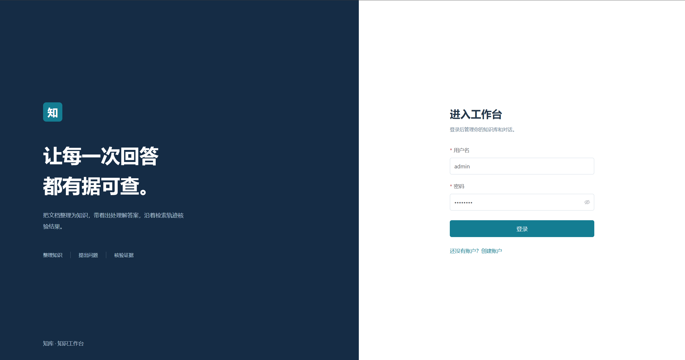
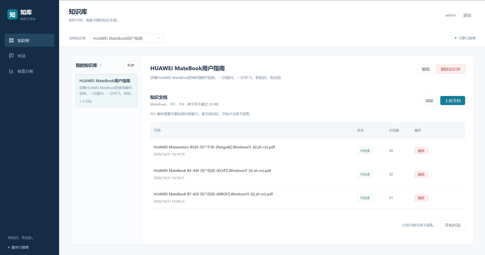
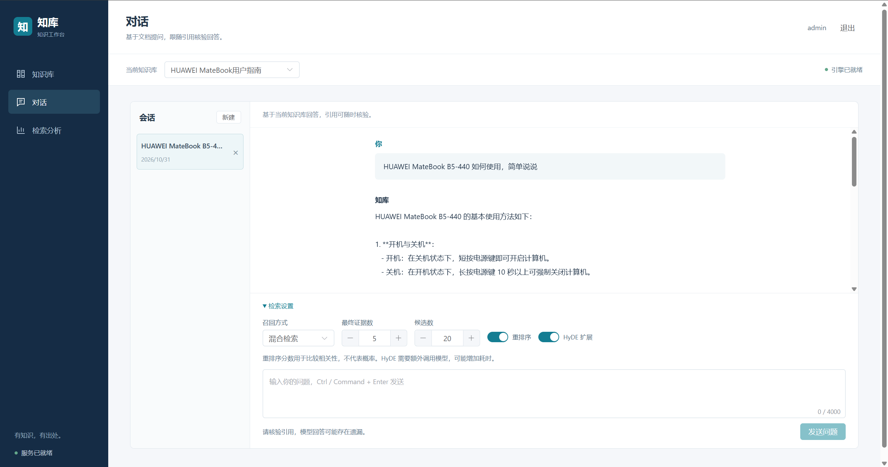
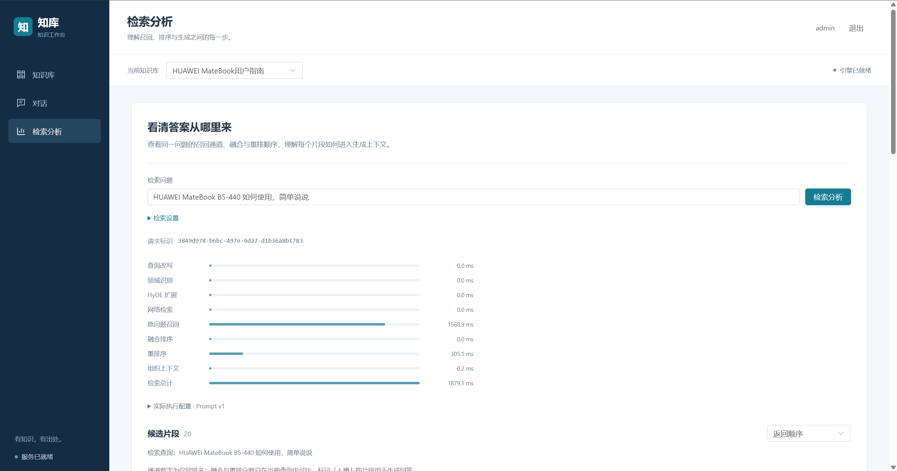
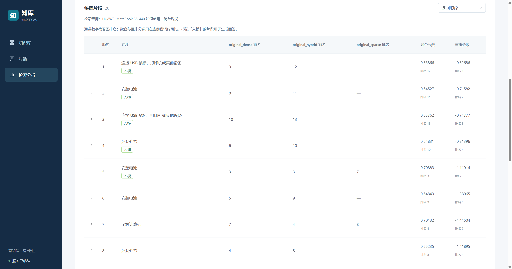
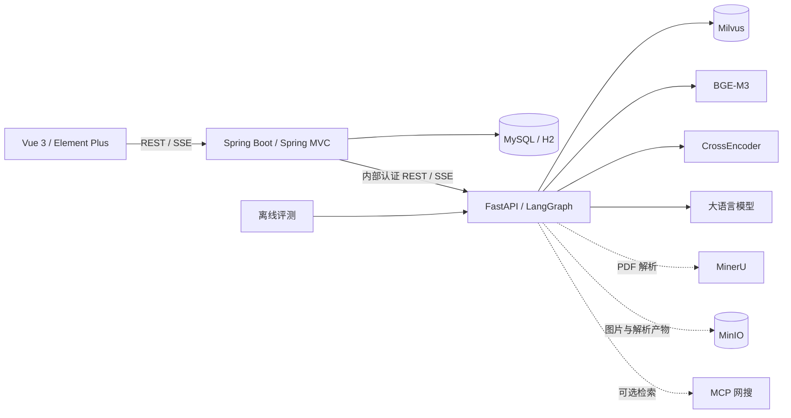
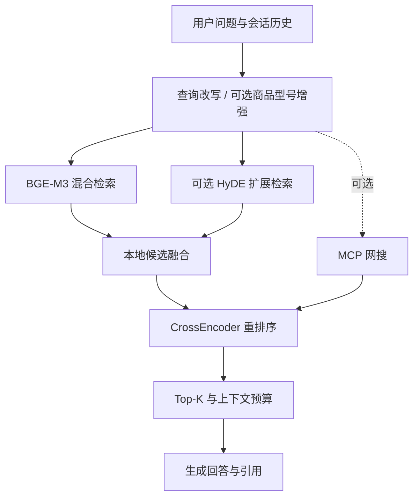

# 智库引擎 Knowledge Engine


**让文档成为可检索、可追溯的知识。**

智库引擎是一个面向技术手册、产品资料和企业文档的 RAG 知识库问答系统。通过结构化文档处理、混合检索与重排序，为回答提供可核验的来源，并将召回排名、引用片段和阶段耗时呈现在同一工作台中。

采用 **Java 业务服务 + Python RAG 引擎 + Vue 工作台** 架构，覆盖从文档入库、知识检索到流式问答的完整使用流程。

[功能特性](#功能特性) · [界面预览](#界面预览) · [系统架构](#系统架构) · [快速开始](#快速开始) · [API 文档](docs/api.md) · [评测与验证](#评测与验证)

## 功能特性

| 功能 | 说明 |
| --- | --- |
| 知识库管理 | 创建与维护知识库，上传文档，查看入库状态，支持失败重试与删除 |
| 文档处理 | 支持 Markdown、TXT 和 PDF；按标题组织切片，处理表格，支持可选图片摘要 |
| 混合检索 | BGE-M3 同时生成稠密与学习式稀疏向量，通过 Milvus 融合召回 |
| 检索增强 | 可配置 HyDE 查询扩展、RRF 排名融合、CrossEncoder 重排序与 MCP 网搜 |
| 流式问答 | 支持多轮会话、SSE 增量输出、生成取消、历史消息与引用查看 |
| 检索分析 | 展示召回通道、候选排名、融合与重排分数、入模证据和阶段耗时 |
| 资源隔离 | 用户认证、知识库归属校验，以及知识库 / 文档 / 索引版本三级检索过滤 |
| 工程可靠性 | 内容摘要去重、稳定片段 ID、幂等索引、有界并发、失败状态与统一错误码 |
| 离线评测 | 提供样例语料、标注问题与消融命令，输出 Recall@K、MRR@K 和延迟报告 |

## 界面预览



### 知识库管理

创建知识库、上传文档，集中查看处理进度、片段数量与任务状态。

 

### 智能问答

选择知识库进行多轮对话，实时接收回答，并查看引用来源与历史记录。

 

### 检索分析

对比召回与重排结果，展开证据正文，定位检索策略与阶段耗时。

  



## 系统架构



| 服务 | 职责 |
| --- | --- |
| Java 业务服务 | 用户认证、知识库与文档元数据、导入任务、会话持久化、权限校验与对外 API |
| Python RAG 引擎 | 文档解析、切片、向量化、索引、检索、重排、Prompt 组织与模型调用 |
| Vue 工作台 | 知识库管理、对话交互、引用展示与检索过程分析 |

前端统一访问 Java API。Java 将问题、必要历史和已授权文档范围传入 Python；Python 在向量检索及结果返回时校验知识库与文档版本。

### 检索流程



- **通道融合**：Milvus 使用 WeightedRanker 融合 dense / sparse，默认权重为 0.7 / 0.3。
- **查询融合**：启用 HyDE 时，原查询与扩展查询并行召回，使用 RRF（`k=60`）融合两路本地结果。
- **候选重排**：CrossEncoder 对有限候选评分；不可用时保留融合排序并记录降级原因。
- **证据追踪**：引用对应实际进入生成上下文的片段，候选与耗时快照随会话保存。

## 技术栈

| 分类 | 技术与版本 |
| --- | --- |
| Java 服务 | Java 17、Spring Boot 3.0.5、Spring MVC、MyBatis-Plus 3.5.5 |
| 关系数据库 | MySQL 8.0.36 / H2 2.1.214；MySQL Connector/J 8.0.32 |
| Python 服务 | Python 3.13.8、FastAPI 0.141.1、Uvicorn 0.52.4、Pydantic 2.13.4 |
| RAG 编排 | LangGraph 1.2.11、OpenAI SDK 3.3.1 |
| 模型推理 | FlagEmbedding 1.4.2、sentence-transformers 6.0.0、transformers 5.15.1、PyTorch 2.13.0 |
| 向量检索 | BGE-M3、Milvus 2.5.x、PyMilvus 2.5.18 |
| 前端 | Vue 3.5.44、Vite 7.3.7、Element Plus 2.14.7、JavaScript |
| 构建工具 | Maven 3.9.11、Maven Wrapper 3.3.2、Node.js 24.16.0、npm 11.13.0 |
| 可选服务 | MinerU、MinIO、兼容 Chat Completions 的模型服务、MCP 网搜 |

Python 提供 Windows x64 与 Linux CPU 平台锁文件；前端使用 `package-lock.json`；Maven Wrapper 固定分发版本与校验值。

## 快速开始

以下命令在项目根目录执行，使用 **Windows PowerShell**。准备 Java 17、Python 3.13.8、Node.js 24.16.0，以及可连接的 Milvus 2.5 服务。CPU 推理建议至少 16GB 内存。

### 1. 安装依赖

```powershell
# Python
py -3.13 -m venv .venv
.\.venv\Scripts\python.exe -m pip install -r requirements.txt

# 前端
Push-Location frontend
npm.cmd ci --cache .npm-cache
Pop-Location

# Java
Push-Location java-service
.\mvnw.cmd -s .mvn/settings.xml '-Dmaven.repo.local=.m2' package
Pop-Location
```

已安装 Maven 3.9.11 时，也可使用 `mvn` 执行相同构建参数。Linux CPU 容器使用 `requirements-linux-cpu.lock.txt`。

### 2. 配置环境与模型

```powershell
if (-not (Test-Path .env)) { Copy-Item .env.example .env }

# 下载固定版本的官方 BGE-M3，约 2.3GB
.\.venv\Scripts\python.exe scripts/download-model.py
```

编辑 `.env`，填写模型服务、向量库与本地权重路径：

```dotenv
OPENAI_API_KEY=your-api-key
OPENAI_BASE_URL=https://dashscope.aliyuncs.com/compatible-mode/v1
LLM_MODEL=qwen-flash

MILVUS_URI=http://127.0.0.1:19530
RAG_COLLECTION=knowledge_chunks_v2

BGE_M3_PATH=./models/bge-m3
BGE_RERANKER_LARGE=./models/bge-reranker-large
BGE_DEVICE=cpu
BGE_FP16=false
```

下载脚本保存官方 BGE-M3 的固定 revision 与文件 SHA-256。另需准备 `BAAI/bge-reranker-large` 本地权重，并设置对应路径。BGE-M3 目录应包含 1024 维模型配置及 `sparse_linear.pt`。

使用 NVIDIA GPU 时，先完成上面的依赖安装，再安装 [PyTorch 官方 CUDA 12.6 构建](https://pytorch.org/get-started/previous-versions/#v2130)：

```powershell
.\.venv\Scripts\python.exe -m pip install --force-reinstall --no-deps torch==2.13.0 --index-url https://download.pytorch.org/whl/cu126
.\.venv\Scripts\python.exe -c "import torch; print(torch.__version__, torch.version.cuda, torch.cuda.is_available())"
```

确认最后一项输出 `True`，然后将 `.env` 中的 `BGE_DEVICE` 设为 `cuda:0`、`BGE_FP16` 设为 `true`。嵌入与重排模型共用该设备；CPU 环境保留 `cpu` / `false`。安装 CUDA 构建后，重新安装默认依赖可能覆盖 PyTorch，请再次检查 CUDA 是否可用。

`RAG_SERVICE_KEY` 用于 Java 与 Python 内部认证，首次运行启动脚本时会自动生成并保存。完整配置见 [.env.example](.env.example)。

### 3. 启动基础服务

已有 Milvus 时，直接填写其可访问地址。使用 Docker 部署基础服务时执行：

```powershell
docker compose -f compose.dual-core.yml up -d etcd minio milvus
```

执行 Compose 前需配置模型路径与 `RAG_SERVICE_KEY`；已有服务应避免重复占用端口。

### 4. 启动应用

分别在三个终端中执行：

```powershell
# Python RAG 引擎
.\scripts\start-local.ps1 -Service engine
```

引擎按 `.env` 中的设备配置运行；需要临时强制使用 CPU 时，在命令末尾加 `-Cpu`。

```powershell
# Java 业务服务
.\scripts\start-local.ps1 -Service java
```

```powershell
# Vue 工作台
.\scripts\start-local.ps1 -Service frontend
```

| 地址 | 用途 |
| --- | --- |
| [http://127.0.0.1:5173](http://127.0.0.1:5173) | 前端工作台 |
| [http://127.0.0.1:8080/api/v1/health](http://127.0.0.1:8080/api/v1/health) | 业务服务健康状态 |
| [http://127.0.0.1:8000/docs](http://127.0.0.1:8000/docs) | Python 内部 OpenAPI |

### 5. 开始使用

1. 注册账号并创建知识库。
2. 上传 `samples/manual-ke100.md`，等待文档状态变为 `READY`。
3. 创建会话，提问“KE-100 如何恢复网络配置？”。
4. 展开引用与检索结果，查看来源、候选排名和各阶段耗时。
5. 在检索分析页调整策略，对比混合检索、重排与 HyDE 的结果。

## 配置说明

### 核心配置

| 变量 | 默认值 / 用途 |
| --- | --- |
| `RAG_SERVICE_KEY` | 内部认证密钥，启动脚本可自动生成 |
| `RAG_ENGINE_URL` | `http://127.0.0.1:8000`，Java 访问引擎的地址 |
| `OPENAI_API_KEY` / `OPENAI_BASE_URL` / `LLM_MODEL` | 生成模型的密钥、接口与模型名 |
| `MILVUS_URI` / `MILVUS_TOKEN` | 向量库地址与可选认证 |
| `RAG_COLLECTION` | `knowledge_chunks_v2`，向量集合 |
| `BGE_M3_PATH` / `BGE_RERANKER_LARGE` | 本地嵌入与重排模型目录 |
| `BGE_DEVICE` / `BGE_FP16` | `cpu` / `false`；GPU 可配置 `cuda:0` 与对应 PyTorch 构建 |
| `RAG_DOMAIN_MODE` | `general`；设为 `product` 开启商品型号增强 |
| `RAG_MAX_CONCURRENCY` | `2`，引擎并发上限 |
| `RAG_CHUNK_CHARS` / `RAG_CONTEXT_CHARS` | `1800` / `14000`，切片与上下文字符预算 |
| `RAG_TIMEOUT_SECONDS` / `RAG_INDEX_TIMEOUT_SECONDS` | `120` / `600`，问答与索引超时（秒） |
| `JAVA_PORT` / `TOKEN_HOURS` | `8080` / `24`，业务端口与登录有效时长 |

默认业务库使用 H2，文件位于 `java-service/data/`。用户、文档、任务和会话均由 Java 持久化管理。

### 使用 MySQL

创建 UTF-8 数据库及账号，在 `.env` 中配置：

```dotenv
SPRING_PROFILES_ACTIVE=mysql
DATABASE_URL=jdbc:mysql://127.0.0.1:3306/knowledge_engine?useUnicode=true&characterEncoding=utf8&serverTimezone=UTC
DATABASE_USER=your-database-user
DATABASE_PASSWORD=your-database-password
```

随后启动 Java 服务。应用通过 `schema.sql` 初始化业务表；远程部署时将地址改为数据库实际主机。

### 可选能力

| 能力 | 配置 |
| --- | --- |
| PDF 解析 | `MINERU_BASE_URL`、`MINERU_API_TOKEN` |
| 图片摘要 | `RAG_ENABLE_VLM=true`、`VL_MODEL` |
| 对象存储 | `RAG_ENABLE_MINIO=true`、`MINIO_ENDPOINT`、访问凭据与 Bucket |
| MCP 网搜 | `RAG_ENABLE_WEB=true`、`MCP_DASHSCOPE_BASE_URL`、`MCP_DASHSCOPE_API_KEY` |

普通 Markdown / TXT 入库无需启用上述服务。HyDE 与网搜由每次请求的检索选项控制。

MinerU PDF 按[官方接口流程](https://mineru.net/apiManage/docs)完成上传、轮询和结果包下载。若解析成功但下载结果时出现“MinerU 或解析产物下载服务不可用”，检查代理能否访问结果 CDN；`.env.example` 的 `NO_PROXY` 已包含 `cdn-mineru.openxlab.org.cn`，用于该域名直连。保留现有 `NO_PROXY` 条目，修改后重启 Python 引擎，再点击文档的“重试索引”。

### Docker 部署

```powershell
docker compose -f compose.dual-core.yml up -d --build
```

容器部署工作台地址为 [http://127.0.0.1:8088](http://127.0.0.1:8088)。编排包含 etcd、MinIO、Milvus、Python、Java 与前端，采用命名卷持久化。默认模型镜像为 Linux CPU 环境。

## API 概览

Java 对外路径统一以 `/api/v1` 开头，注册、登录和健康接口以外的请求使用 `Authorization: Bearer <token>`。

| 接口 | 用途 |
| --- | --- |
| `POST /auth/register`、`POST /auth/login`、`GET /auth/me` | 注册、登录与当前用户 |
| `GET/POST /knowledge-bases`、`GET/PATCH/DELETE /knowledge-bases/{id}` | 知识库管理 |
| `GET/POST /knowledge-bases/{id}/documents` | 文档列表与上传 |
| `GET /jobs/{id}`、`POST /documents/{id}/retry`、`DELETE /documents/{id}` | 状态查询、失败重试与删除 |
| `GET/POST /sessions`、`GET/DELETE /sessions/{id}` | 会话与历史 |
| `POST /sessions/{id}/messages` | 非流式问答 |
| `POST /sessions/{id}/messages/stream` | SSE 流式问答 |
| `POST /knowledge-bases/{id}/search` | 检索分析 |

问答请求示例：

```json
{
  "query": "KE-100 如何恢复网络配置？",
  "retrieval": {
    "mode": "hybrid",
    "top_k": 5,
    "candidate_k": 20,
    "use_rerank": true,
    "use_hyde": false,
    "use_web": false
  }
}
```

SSE 事件包括 `meta`、`retrieval`、`delta`、`done` 和 `error`。每个请求携带 `request_id`，便于关联页面、Java 与 Python 日志。

详细字段、错误码与内部服务协议见 [API 使用说明](docs/api.md) 和 [接口契约](contracts/README.md)。

## 评测与验证

### 检索消融

提供四篇中文样例文档、20 条有答案问题和两条无答案问题，划分开发集与保留验证集。标注采用文档粒度，计算前 K 个片段覆盖相关文档的 Recall@K 与首条相关结果的 MRR@K。

```powershell
# 基础服务与真实模型就绪后，索引样例并执行评测
.\.venv\Scripts\python.exe -m evaluation.run --index-samples --split holdout

# 指定策略与候选预算
.\.venv\Scripts\python.exe -m evaluation.run --strategies dense hybrid rerank hyde --k 5 --candidate-k 20
```

报告输出至 `evaluation/reports/`，包含逐题结果、策略配置、错误与降级记录、Recall@K、MRR@K、平均延迟及 P50 / P95。无答案问题单独列出，用于结合生成结果检查拒答行为。

### 自动化验证

```powershell
# Python、Java、前端测试与构建，以及跨进程协议冒烟
.\scripts\verify.ps1

# 单独执行协议冒烟；需先构建 Java jar
.\.venv\Scripts\python.exe scripts/smoke.py

# 检查环境、模型身份与向量库连接
.\.venv\Scripts\python.exe scripts/check-environment.py
```

协议冒烟使用明确的模型与存储替身验证 HTTP、权限、上传、SSE 和消息持久化；检索效果评测通过实际引擎与向量库执行。

## 项目结构

```text
knowledge-engine/
├── java-service/       # Spring Boot 业务服务与 SQL
├── rag_engine/         # FastAPI、LangGraph、解析、模型与检索
├── frontend/           # Vue 工作台
├── contracts/          # 服务契约、JSON Schema 与 OpenAPI
├── evaluation/         # 评测数据、指标与消融命令
├── samples/            # 中文样例文档
├── tests/              # Python 核心与接口回归
├── scripts/            # 启动、模型下载、环境检查与验证
├── deploy/             # Dockerfile 与 Nginx
├── docs/               # API、架构及工程文档
├── .env.example        # 环境变量示例
├── compose.dual-core.yml
└── README.md
```

## 运行说明

- 默认按单 Java 实例、单 Python worker 部署，使用有界执行器与并发限制管理任务。
- 文档采用内容摘要与稳定 ID 实现重复上传去重、幂等索引和失败重试；仅 `READY` 文档参与检索。
- SQL 与向量索引通过任务状态、幂等操作和补偿清理保持一致，删除中的文档立即排除出检索范围。
- 支持 Markdown、TXT 和 PDF，默认上传上限为 20MB；PDF 和图像能力需要相应外部服务。
- 上下文按字符预算裁剪，重排分数用于候选相关性比较，不作为答案正确率。
- `/health/live` 检查进程存活，`/health/ready` 检查配置、模型与依赖状态；模型采用懒加载，首次索引会触发加载。
